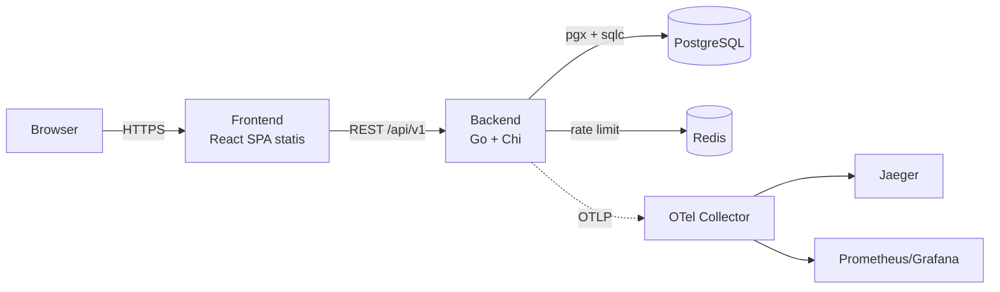
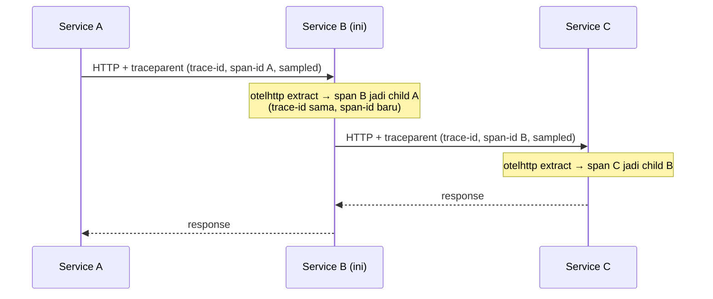

# Boilerplate Fullstack — Arsitektur Template

**Status:** Disepakati · 12 November 2026
**Repo:** `PRJ-0001_boilerplate`
**Module Go:** `github.com/ppabimanyu/boilerplate-fullstack`
**Implementasi:** belum dimulai — dokumen ini hanya arsitektur.

Boilerplate general-purpose: fondasi backend, frontend, struktur project, dan observability. **Tidak ada authentication maupun fitur domain** — semua fitur bisnis ditambahkan per project di atas fondasi ini.

## 1. Ruang lingkup

Disertakan:

- Scaffold backend Go: HTTP server, config, middleware, health check, graceful shutdown.
- Scaffold frontend React: routing, data layer, API client, UI kit.
- Struktur project dan konvensi penamaan yang konsisten.
- Konektivitas PostgreSQL + workflow migrasi dan query (tanpa skema domain).
- Redis untuk rate limiting umum.
- Observability: tracing, metrics, structured logging, trace propagation.
- Docker, CI, README, dan dokumentasi arsitektur.

Tidak disertakan:

- Authentication, session, RBAC, email, atau reset password.
- Modul CRUD/domain contoh.
- Multi-tenancy, billing, job queue, realtime/WebSocket, i18n, GraphQL.
- Orkestrasi microservice (service discovery, API gateway terpisah, Kubernetes).

## 2. Prinsip desain

- **General purpose** — tidak ada asumsi domain; template harus netral untuk SaaS, internal tools, maupun project client.
- **Satu deployable service (microservice-ready)** — backend berjalan sebagai satu service; tracing dan logging disiapkan agar siap dipecah tanpa perubahan kode.
- **Tanpa layer service** — business logic ditulis di handler saat fitur ditambahkan; akses data lewat interface (port) di domain.
- **Kontrak API eksplisit** — REST `/api/v1` dengan OpenAPI; tipe frontend di-generate dari kontrak.
- **12-factor** — konfigurasi via environment, stateless, siap container.
- **Zero lock-in** — seluruh komponen open source dan dapat dijalankan di mana saja.

## 3. Tech stack

### 3.1 Frontend

| Kebutuhan | Pilihan |
| --- | --- |
| Framework | React 19 |
| Build tool | Vite |
| Bahasa | TypeScript |
| Styling | Tailwind CSS v4 |
| Komponen UI | shadcn/ui (Radix UI primitives) |
| Ikon | lucide-react |
| Routing | React Router v7 |
| Server state | TanStack Query v5 |
| HTTP client | openapi-fetch + tipe dari openapi-typescript |
| Form & validasi | React Hook Form + Zod |
| Notifikasi | sonner |
| Client state | Zustand (opsional, ditambahkan saat dibutuhkan) |
| Testing | Vitest + React Testing Library + MSW |
| Lint/format | ESLint + Prettier |

Playwright E2E tidak disertakan; dapat ditambahkan per project.

### 3.2 Backend

| Kebutuhan | Pilihan |
| --- | --- |
| Router | chi (`go-chi/chi/v5`) |
| Driver DB | `pgx/v5` |
| Query | sqlc (generate dari SQL) |
| Migrasi | goose |
| Cache/rate limit | Redis + `go-redis/v9` |
| Config | environment (`caarlos0/env`) |
| Logging | `log/slog` + custom handler (`trace_id`, `span_id`) |
| Tracing | OpenTelemetry SDK + OTLP exporter |
| Metrics | OpenTelemetry metrics + OTLP exporter |
| Instrumentasi | `otelhttp` (server/client), `otelpgx` (PostgreSQL), runtime Go |
| Rate limit | middleware Redis (general, bukan auth) |
| Dokumentasi API | swaggo/swag → OpenAPI 3 |
| Testing | testify + testcontainers-go |
| Lint | golangci-lint |
| Hot reload (dev) | air |

### 3.3 Infrastructure

- PostgreSQL sebagai fondasi data; migrasi awal tidak membuat tabel domain.
- Redis untuk rate limiting umum.
- OTel Collector (profil development) untuk menerima traces dan metrics via OTLP.

## 4. Arsitektur sistem



- Frontend adalah **static build** (HTML/JS/CSS) — tidak ada runtime Node di production.
- Backend adalah satu binary Go stateless — mudah di-scale horizontal.
- Di production, frontend dan backend dilayani dari **satu origin** melalui reverse proxy (nginx/Caddy). Di development, Vite mem-proxy `/api` ke backend.

## 5. Struktur repo

```
.
├── backend/
│   ├── cmd/api/main.go
│   ├── internal/
│   │   ├── httphandler/   # httphandler_router.go, httphandler_health.go
│   │   ├── middleware/    # middleware_*.go
│   │   ├── config/        # env → struct, validasi fail-fast
│   │   ├── domain/        # tempat entity/const/port fitur baru
│   │   ├── repository/    # sqlcgen/ + repo_pg_*.go + repo_svc_*.go
│   │   ├── infra/         # db pool, redis, otel, logger setup
│   │   └── pkg/           # slogx, problem, validate, pagination
│   ├── db/
│   │   ├── migrations/    # goose (tanpa tabel domain)
│   │   ├── queries/       # sqlc (query infrastruktur + query fitur nanti)
│   │   └── sqlc.yaml
│   ├── docs/              # openapi (generated)
│   ├── Dockerfile
│   ├── Makefile
│   └── go.mod
├── frontend/
│   ├── src/
│   │   ├── app/           # router, providers, layout
│   │   ├── components/
│   │   │   ├── ui/        # shadcn components
│   │   │   └── shared/    # komponen lintas fitur
│   │   ├── features/      # kosong; fitur ditambahkan per project
│   │   ├── lib/           # api client, config, utils
│   │   ├── hooks/
│   │   ├── stores/
│   │   └── types/         # generated dari openapi
│   ├── Dockerfile
│   └── vite.config.ts
├── deploy/
│   ├── docker-compose.yml
│   ├── nginx.conf
│   └── otel-collector.yaml
├── docs/
│   └── architecture.md
├── .github/workflows/ci.yml
├── Makefile
├── .env.example
├── README.md
└── LICENSE
```

## 6. Arsitektur backend

**Pola:** `httphandler` → `repository`. Tidak ada layer service. Saat fitur ditambahkan, handler berisi business logic dan bergantung pada interface (port) di `domain`; implementasi port ada di `repository`.

**Guardrails layer:**

- `httphandler` hanya boleh mengimpor `domain` dan `pkg` — dilarang mengimpor `pgx`, sqlc, atau package `repository` secara langsung.
- `repository` hanya berisi akses data/adapter tanpa business rule.
- `domain` tidak mengimpor package internal lain.
- Logic yang dipakai lintas handler ditempatkan di `pkg`.

**Request lifecycle:**

1. Middleware chain (`internal/middleware`): recoverer → otelhttp → request ID → access logger → real IP → rate limit → CORS.
2. Handler (`httphandler_*.go`): decode + validasi input, jalankan logic.
3. Repository: `repo_pg_*` menjalankan query sqlc/transaksi, atau `repo_svc_*` memanggil external service.
4. Response: JSON; error mengikuti RFC 7807 (`application/problem+json`).

**Naming conventions:**

| Folder | Pola file | Isi |
| --- | --- | --- |
| `httphandler/` | `httphandler_*.go`, `httphandler_router.go` | Handler per resource; DTO request/response di file handler yang sama; router di `httphandler_router.go` |
| `middleware/` | `middleware_*.go` | Request ID, access log, recovery, CORS, rate limit |
| `domain/` | `const_*.go` | Konstanta domain |
| `domain/` | `entity_*.go` | Struct yang merepresentasikan tabel/DB |
| `domain/` | `obj_*.go` | Struct object umum (bukan entity DB) |
| `domain/` | `port_repo_*.go` | Interface repository |
| `domain/` | `port_svc_*.go` | Interface external service; struct param & result di file yang sama |
| `repository/` | `repo_pg_*.go` (mis. `repo_pg_user.go`) | Implementasi query DB |
| `repository/` | `repo_svc_*.go` | Implementasi external service |

**Error handling:** error domain (`ErrNotFound`, `ErrConflict`, `ErrValidation`) dipetakan ke status HTTP di satu tempat. Error internal tidak pernah bocor ke client; di-log dengan request context.

**Konfigurasi:** semua via environment, divalidasi saat startup (fail-fast). Variabel utama: `APP_ENV`, `PORT`, `DATABASE_URL`, `REDIS_URL`, `CORS_ALLOWED_ORIGINS`, `RATE_LIMIT_*`, `LOG_LEVEL`, `OTEL_*`.

**Operasional:** graceful shutdown (termasuk flush `TracerProvider` dan `MeterProvider`), timeout HTTP server, limit ukuran body, health check `GET /healthz` (liveness) dan `GET /readyz` (cek DB + Redis).

## 7. Observability

- **Tracing:** `otelhttp` dipasang sebagai middleware terluar sehingga setiap request memiliki span. `repo_pg_*` (via `otelpgx`) dan HTTP client keluar (`otelhttp`) meneruskan context agar span anak terbentuk. Exporter OTLP; endpoint, nama service, dan rasio sampling diatur via environment (`OTEL_EXPORTER_OTLP_ENDPOINT`, `OTEL_SERVICE_NAME`, `OTEL_TRACES_SAMPLER_ARG`).
- **Metrics:** OpenTelemetry metrics diekspor via OTLP (satu pipeline dengan tracing) — request rate, error rate, duration, in-flight, dan runtime Go.
- **Logging:** `log/slog` (JSON) dengan custom handler yang otomatis menambahkan `trace_id` dan `span_id` dari span context pada setiap `slog.*Context(ctx, ...)`. Access log mencatat method, path, status, latency, ukuran response, dan `request_id`. Tidak ada `user_id` karena boilerplate ini tidak memiliki auth; tambahkan context key tersebut saat project menambahkan authentication.
- **Development:** docker-compose menyediakan profil opsional OTel Collector (traces → Jaeger, metrics → Prometheus) dengan Grafana opsional.

**Propagasi trace antar-service (microservice-ready):**



- **Request masuk — extract atau create:** `otelhttp` membaca header `traceparent`/`tracestate` melalui global propagator. Jika valid, span baru menjadi child dari remote parent (trace_id diteruskan). Jika tidak ada/tidak valid, dibuat root span baru.
- **Request keluar — inject:** context request wajib diteruskan (`http.NewRequestWithContext(r.Context(), ...)`); transport `otelhttp` menyisipkan `traceparent` dengan trace_id yang sama dan span_id span aktif.
- **Propagator global:** `propagation.NewCompositeTextMapPropagator(propagation.TraceContext{}, propagation.Baggage{})`. Tambahkan `B3`/`B3Multi` jika berinteraksi dengan sistem berbasis Zipkin.
- **Sampling konsisten:** `ParentBased(TraceIDRatioBased(rasio))` — keputusan diambil di entry point dan diwariskan lewat flag `sampled`.
- **Korelasi untuk client:** response header `X-Trace-Id` diisi dari span context.
- **Prasyarat:** reverse proxy/API gateway harus meneruskan `traceparent`/`tracestate`; jangan memakai `context.Background()` pada jalur request; pekerjaan async memakai span link.

## 8. Rate limiting (Redis)

- Middleware general berbasis Redis (fixed window per IP/route key), bukan terikat auth.
- Limit dan window diatur via environment (`RATE_LIMIT_REQUESTS`, `RATE_LIMIT_WINDOW`).
- Jika Redis tidak tersedia, limiter **fail-open** dan error di-log agar API tidak lumpuh total.
- Rate limit dapat dipasang global atau per route group saat fitur ditambahkan.

## 9. Database & workflow

- Perubahan skema selalu lewat migrasi goose (`goose up`), tidak pernah manual di production.
- Query ditulis di `db/queries/*.sql` dengan anotasi (`-- name: ListItems :many`), lalu `sqlc generate`.
- Tidak ada tabel domain di boilerplate. Untuk memvalidasi pipeline sqlc, disediakan query infrastruktur sederhana (mis. `Ping`) yang tidak membuat domain apa pun.
- Saat fitur ditambahkan: sqlc men-generate model ke package internal `repository/sqlcgen`; `repo_pg_*` memetakan model tersebut ke `entity_*` di domain (dua arah).
- Operasi multi-tabel yang harus atomik dibungkus dalam satu method repo; handler tidak mengelola transaksi langsung.
- Konvensi saat menambah skema: tabel plural `snake_case`, kolom `snake_case`, foreign key `<table>_id`, timestamp `timestamptz` (UTC), primary key UUID dari database.

## 10. Arsitektur frontend

- **Feature-based:** fitur baru ditempatkan di `features/<nama>/` berisi komponen, hooks, api, dan tipe.
- **Routing:** React Router v7 dengan layout aplikasi; tanpa auth guard karena tidak ada auth.
- **Server state:** TanStack Query; `QueryClientProvider` disiapkan di `app/providers`; query key terpusat per fitur.
- **API client:** `openapi-fetch` dengan tipe hasil `openapi-typescript`; base URL dari `VITE_API_URL`.
- **Form:** React Hook Form + Zod disiapkan untuk fitur yang membutuhkan form.
- **UI:** shadcn components di-commit ke repo (`components/ui`), theme provider light/dark, sonner untuk toast. Komposisi netral domain ada di `components/shared`; daftar baseline dan batasannya diatur ADR-0002.
- **Brand:** `frontend/src/brand` memegang nama service (`VITE_APP_NAME`), tanda registrasi, dan pembingkaian halaman. Tinta merek (`--brand`, petrol) dipetakan ke `--primary`, jadi semua tombol, link, dan fokus mewarisinya; warna lain hanya semantik. Spesimen lengkap ada di section House style pada `_gallery`.
- **State list:** `useListQuery` memegang `limit`, `offset`, dan `q` di URL untuk semua halaman list; komponen `Pagination` dan `DataTable` tetap menerima props tanpa tahu router.
- **Gallery:** `_gallery` hanya aktif di development dan berisi contoh setiap primitive dan shared component.
- **Error handling:** error element di route root untuk crash saat render, error boundary global untuk kegagalan di luar router, dan mapping problem+json ke pesan UI.
- **Maintenance:** build dengan `VITE_MAINTENANCE_MODE=true` mengganti seluruh aplikasi dengan halaman maintenance, termasuk deep link. Route `/maintenance` tetap tersedia untuk redirect di reverse proxy.
- **Env:** `VITE_API_URL`; untuk deployment same-origin gunakan path relatif `/api/v1`. Di development, Vite mem-proxy `/api` ke backend.

## 11. Konvensi API

- Base path `/api/v1`, resource plural.
- Health check di luar prefix API: `GET /healthz`, `GET /readyz`.
- JSON `camelCase`.
- Error: RFC 7807 (`application/problem+json`).
- Pagination standar saat fitur ditambahkan: `?limit=&offset=` → `{ "items": [], "total": 0, "limit": 20, "offset": 0 }`.
- Waktu: RFC 3339 UTC. ID: UUID dari database.
- OpenAPI di-generate dari anotasi Go; tipe & client frontend di-generate dari spec tersebut (satu sumber kebenaran).

## 12. Docker & deployment

- **Backend image:** multi-stage (`golang:alpine` builder → `distroless/static:nonroot`), binary statis, `CGO_ENABLED=0`.
- **Frontend image:** multi-stage (`node:alpine` build → `nginx:alpine`), SPA fallback, proxy `/api` ke backend. `VITE_API_URL` di-bake saat build (Docker build arg).
- **docker-compose (development & VPS kecil):** `db` (volume + healthcheck), `redis` (healthcheck), `migrate` (job `goose up`), `backend` (menunggu db & redis healthy + migrate selesai), `frontend`. Cukup `docker compose up -d`.
- **Production:** reverse proxy dengan TLS (Caddy/Traefik/Cloudflare), backup PostgreSQL terjadwal, migrasi dijalankan saat deploy (`goose up` sebagai step CI atau init container).
- **Observability (opsional):** profil docker-compose untuk OTel Collector (traces → Jaeger, metrics → Prometheus) dengan Grafana opsional.
- Semua konfigurasi lewat `.env` yang didokumentasikan di `.env.example`.

## 13. CI/CD & quality gates

GitHub Actions, empat job paralel:

1. **backend** — golangci-lint, govulncheck, `go test ./...`, build binary.
2. **frontend** — ESLint, `tsc --noEmit`, Vitest, `vite build`.
3. **generate-check** — `sqlc generate`, `swag init`, `openapi-typescript`; gagal jika ada diff.
4. **docker** — build kedua image (cache BuildKit) dan scan Trivy (severity high/critical).

Deploy per project ditambahkan sesuai target (VPS, PaaS, cloud).

## 14. Testing

- **Backend unit:** handler dengan port interface di-mock (testify).
- **Backend integration:** repository + DB nyata via testcontainers-go.
- **Frontend unit/component:** Vitest + RTL + MSW.
- **E2E:** tidak disertakan; Playwright dapat ditambahkan per project.

## 15. Fitur baseline (infrastruktur)

- Health check + graceful shutdown.
- Middleware: request ID, access log, recovery, CORS, rate limit Redis.
- Koneksi PostgreSQL + workflow migrasi goose + sqlc.
- Redis client + rate limiting general.
- OpenAPI generation + tipe frontend.
- Observability: tracing + metrics OTel (OTLP), slog dengan `trace_id`/`span_id`.
- Docker compose satu perintah.
- CI GitHub Actions.
- README + docs arsitektur.

Tidak ada authentication, RBAC, email, atau modul CRUD.

## 16. Cara memakai untuk project baru

1. Clone repo / jadikan template GitHub.
2. Rename module Go di `go.mod` dan import path.
3. Salin `.env.example` → `.env`, isi konfigurasi.
4. `docker compose up -d` → `make migrate-up`.
5. Tambahkan fitur dengan pola: migration → query sqlc → interface/entity di domain → implementasi repo → handler → feature frontend.
6. Regenerate OpenAPI + tipe frontend (`make generate`).
7. Update branding (nama, logo, theme).

## 17. Non-goals

- Authentication, session, RBAC, email, reset password.
- Modul contoh/CRUD bawaan.
- Multi-tenancy (jalur ekstensi: `tenant_id` + PostgreSQL RLS).
- Billing/subscription.
- Job queue/background worker (kandidat: River atau Asynq).
- Realtime/WebSocket, i18n, GraphQL.
- Orkestrasi microservice (Kubernetes, service discovery, API gateway terpisah) — service tunggal ini sudah microservice-ready dari sisi instrumentasi.

## 18. Keputusan terbuka

- Backend observability production (Jaeger/Tempo, Prometheus/Grafana, atau cloud APM) — development memakai collector + Jaeger.
- Contoh query infrastruktur untuk memvalidasi sqlc (mis. `Ping`) — diputuskan saat implementasi.
- Package manager frontend (npm/pnpm) — diputuskan saat implementasi.

## 19. Rencana scaffold (setelah disetujui)

1. Init monorepo + tooling dasar (Makefile, env, lint).
2. Skeleton backend: config, slog handler, tracing & metrics (OTel), Chi, middleware, health, Redis rate limit.
3. Koneksi PostgreSQL + goose + sqlc (tanpa tabel domain).
4. OpenAPI setup + generate tipe frontend.
5. Skeleton frontend: Vite, Tailwind, shadcn, router, providers, API client.
6. Dockerfile + compose + observability profile.
7. CI, README, smoke test `docker compose up`.
